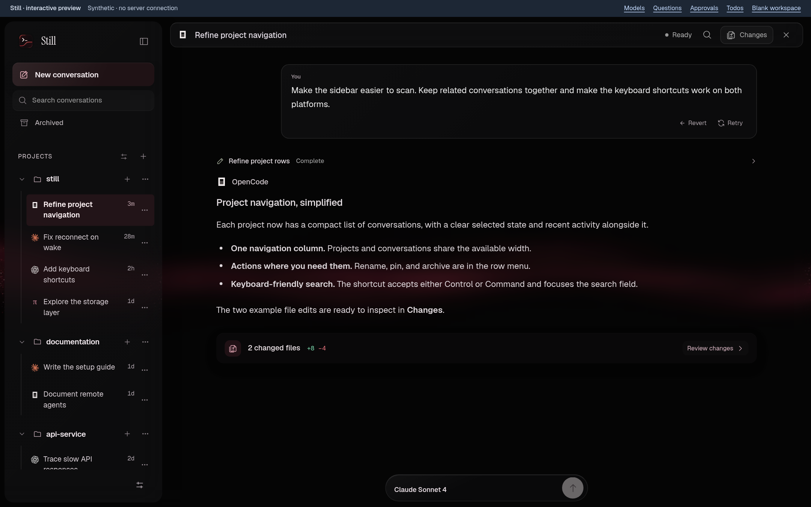
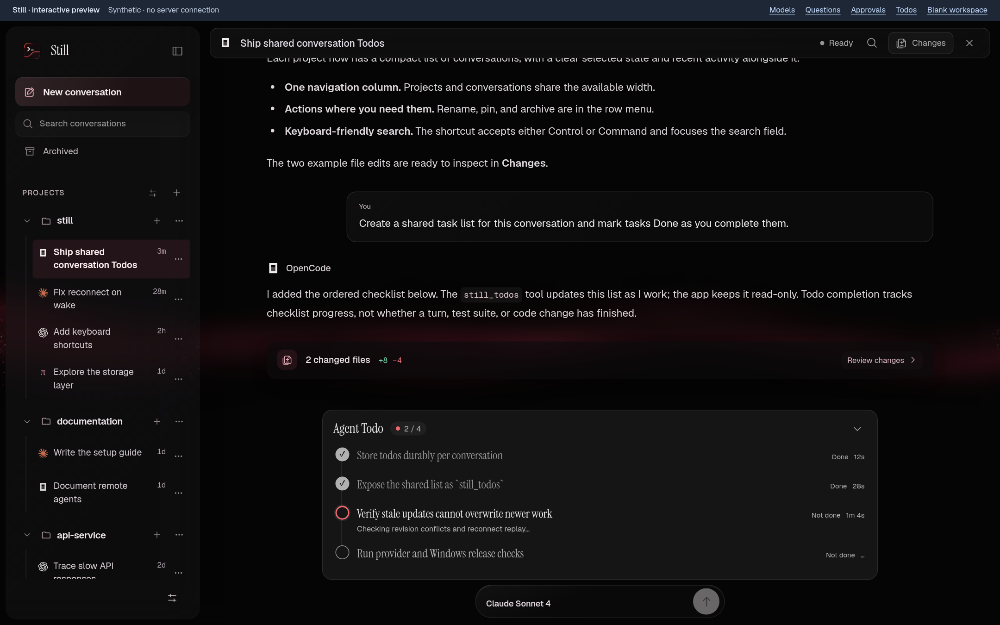
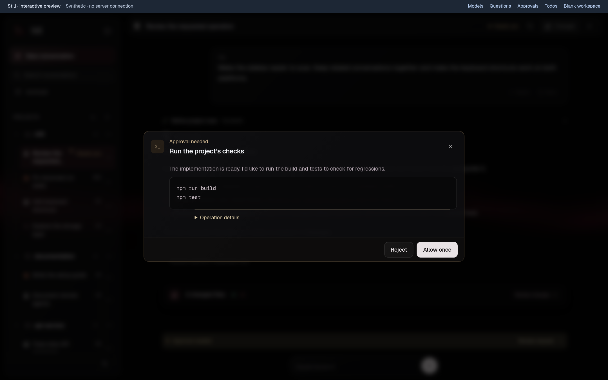
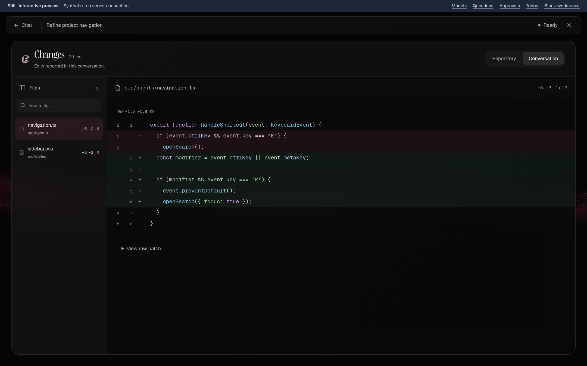
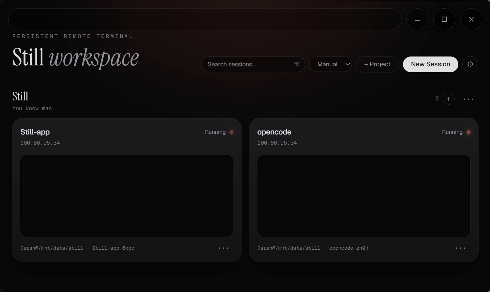
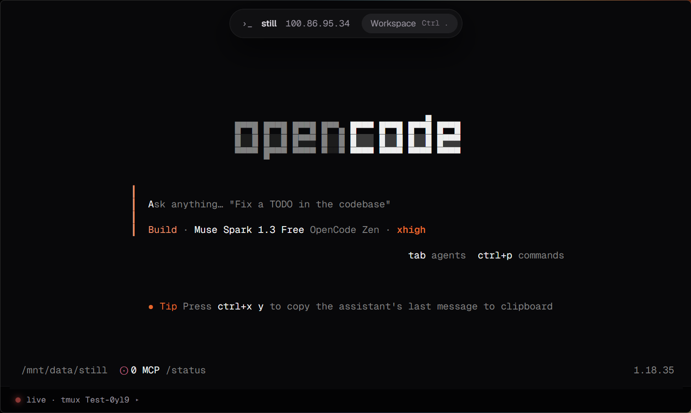

# Still

**Vibe code. Close the laptop. Pick up where you left off.**

Still is a desktop home for **remote coding agents and persistent SSH terminals**.
Give your agent a task, follow its progress, review the changes, and come back later
without starting the conversation from scratch. Your server does the work; your
laptop doesn't have to babysit it.

> Your connection can drop. Your work doesn't have to.

[](https://github.com/Dummy-pixel-hash/still-app/releases/latest)
[](https://github.com/Dummy-pixel-hash/still-app/releases/tag/v0.1.1)
[](https://github.com/Dummy-pixel-hash/still-app/actions/workflows/windows-arm64.yml)
[](https://github.com/Dummy-pixel-hash/still-app/actions/workflows/windows-x64.yml)
[](LICENSE)

[Download](#download) · [Get started](#get-started) · [Agents panel](#meet-the-agents-panel) · [Try the preview](#try-the-ui-preview) · [Develop](#develop)



*The current Agents UI, using clearly labelled example data—not a live agent run.
[Try it yourself in the browser.](#try-the-ui-preview)*

## Less babysitting, more building

- **One home for your coding agents.** Use OpenCode, Claude Code, Codex, Pi, or
  Gemini CLI through a conversation interface—not just a terminal full of output.
- **Keep projects and conversations together.** Pick a remote folder, start a task,
  and find it again without hunting through shell tabs.
- **See what happened.** Read tool activity, answer questions, respond to approval
  requests, follow agent-managed Todos, and inspect file changes.
- **Leave the laptop out of it.** New managed agent runs live in detached workers
  on your server. Terminal cards use tmux to keep their remote sessions around.

**Two ways to work:** use **Agents** for a guided conversation, or open a
**terminal card** for your shell, a coding-agent TUI, or that long-running build.
You don't need to create a terminal card before using Agents.

## Download

**Want the Agents panel? Get the [v0.1.1 Preview](https://github.com/Dummy-pixel-hash/still-app/releases/tag/v0.1.1).**
It includes 11 verified packages, SHA-256 checksums, and a build manifest. Pick the
package that matches your computer below—no GitHub sign-in or workflow ZIP needed.

| Your computer | Where to get Still |
| --- | --- |
| Windows x64 · Intel / AMD | [Setup .exe](https://github.com/Dummy-pixel-hash/still-app/releases/download/v0.1.1/Still_0.1.1_windows-x64-setup.exe) · [MSI](https://github.com/Dummy-pixel-hash/still-app/releases/download/v0.1.1/Still_0.1.1_windows-x64.msi) |
| Windows ARM64 | [Setup .exe](https://github.com/Dummy-pixel-hash/still-app/releases/download/v0.1.1/Still_0.1.1_windows-arm64-setup.exe) · [MSI](https://github.com/Dummy-pixel-hash/still-app/releases/download/v0.1.1/Still_0.1.1_windows-arm64.msi) |
| Linux x64 · Intel / AMD | [AppImage](https://github.com/Dummy-pixel-hash/still-app/releases/download/v0.1.1/Still_0.1.1_linux-x64.AppImage) · [.deb](https://github.com/Dummy-pixel-hash/still-app/releases/download/v0.1.1/Still_0.1.1_linux-x64.deb) · [.rpm](https://github.com/Dummy-pixel-hash/still-app/releases/download/v0.1.1/Still_0.1.1_linux-x64.rpm) |
| Linux ARM64 | [AppImage](https://github.com/Dummy-pixel-hash/still-app/releases/download/v0.1.1/Still_0.1.1_linux-arm64.AppImage) · [.deb](https://github.com/Dummy-pixel-hash/still-app/releases/download/v0.1.1/Still_0.1.1_linux-arm64.deb) · [.rpm](https://github.com/Dummy-pixel-hash/still-app/releases/download/v0.1.1/Still_0.1.1_linux-arm64.rpm) |
| macOS Intel | [DMG](https://github.com/Dummy-pixel-hash/still-app/releases/download/v0.1.1/Still_0.1.1_macos-x64.dmg) — unsigned and not notarized. |
| macOS Apple Silicon | Unavailable in this preview: GitHub could not allocate an ARM64 runner after two attempts. [Build details](https://github.com/Dummy-pixel-hash/still-app/actions/runs/41870543271). |

> [!WARNING]
> **v0.1.1 is a preview with known UI issues**, including narrow-window navigation
> and the initial prompt remaining in the composer. Read the
> [release notes](https://github.com/Dummy-pixel-hash/still-app/releases/tag/v0.1.1)
> before installing. The latest stable release, **v0.1.0**, is unchanged and predates
> Agents. Windows installers are unsigned; macOS builds are unsigned and not notarized.

On Linux, make the downloaded AppImage executable, then launch it:

```sh
chmod +x Still_*.AppImage
./Still_*.AppImage
```

## Get started

### Bring a server, not a second laptop

You'll need an **SSH-accessible server and an account you control**—a VPS, home
server, or development box works. Your project files live there.

- **For Agents:** install **Node.js 22+ (recommended)** and at least one supported
  coding agent on the server. Still's worker needs Node.js 20+, but individual agents
  can require newer versions. Complete the agent's sign-in there before starting a conversation.
- **For terminal cards:** install **tmux** on the server. It's the piece that keeps
  your terminal session alive when Still disconnects.
- **For file attachments:** the server's SSH service must support **SFTP**.

Still uses your existing agent accounts. It doesn't include a model subscription,
provide a hosted server, or make paid model usage free.

<details>
<summary>Need a coding agent? Install one on your server</summary>

Run the matching commands **on the server**, not on the computer running Still.
Choose one to start; you don't need all five.

| Agent | Install | Sign in on the server |
| --- | --- | --- |
| OpenCode v2 | `npm install -g @opencode/cli` | `opencode auth login` |
| Claude Code | `npm install -g @anthropic-ai/claude-code` | `claude auth login` |
| Codex | `npm install -g @openai/codex` | `codex login --device-auth` |
| Pi | `npm install -g @mariozechner/pi-coding-agent` | Run `pi`, then use `/login`. |
| Gemini CLI with ACP support | `npm install -g @google/gemini-cli` | Run `gemini` and complete sign-in. |

In Still, **Agents → Settings** lets you inspect agent availability, check versions,
set executable paths, and copy installation or sign-in commands. Models and
available controls depend on the installed agent and its account.

</details>

### Your first agent conversation

1. Open **Agents** from the workspace.
2. Use **Add project** (the **+** beside Projects), choose a saved server or
   **Add a server**, and enter the remote project folder—for example, `/srv/my-app`.
3. Verify the server's fingerprint if prompted, then sign in. Select **Open folder**.
4. Choose a coding agent. Still connects it and loads its models automatically;
   choose your model and any supported mode or reasoning options **before sending**.
5. Describe what you want. You can also start with **Build a feature**,
   **Explore the code**, or **Review changes**.
6. Follow the conversation, answer any questions, and open **Changes** to inspect
   the edits. Reopen the saved conversation later to reconnect and catch up.

**Blank-prompt panic? Steal this:**

```text
First, explore this project and explain how it works in plain English.
I want to add a dark-mode toggle that remembers the user's choice.
Ask me about anything unclear before editing. Keep a Todo list as you work,
follow the project's existing patterns, and run the relevant checks.
Finish by explaining what changed and anything I should test myself.
```

### Prefer the terminal?

Choose **New session**, enter your server details (or use a saved preset), then
select **Create & connect**. Verify the host, sign in, and work as usual. Each card
has its own tmux session; reopen the same card to reattach instead of starting over.

## Meet the Agents panel

The loop is simple: **ask → follow along → respond → review**.

### A project sidebar that remembers where you were

Projects pair a **server/account with a remote folder**. Conversations stay grouped
under that project, with search, rename, pin, archive, and sorting controls. Terminal
projects and Agent projects are separate, so organizing one doesn't rearrange the other.

History and drafts are saved on your device. Saved conversations remain readable
offline; selecting one reconnects to its saved server and automatically attempts to
reattach to the same worker or resume the provider session. Host verification and
credential checks still apply. This is local history, not cross-device cloud sync.

### More than a chat box

| In the panel | What you can do |
| --- | --- |
| **Agent, model, and reasoning controls** | Choose a coding agent for a new conversation; search its models and use the modes or reasoning levels it actually exposes. Changing a setting doesn't send your draft. |
| **Conversation and live activity** | Read formatted replies and code, follow the current tool activity, expand tool details, and copy code snippets. |
| **Questions and approvals** | Answer the agent's questions or allow/reject an operation when requested. Expand a request for a focused view with its actions kept in reach. |
| **Agent Todos** | Follow an agent-maintained checklist with Done/Not done states, active-task detail, and timings. Expand the progress pill above the composer to see the list. |
| **Attachments** | Use the paperclip, paste, or drop files into your draft. Files upload over SFTP and are shared with the agent by remote path. Image understanding depends on the agent. |
| **Commands and skills** | Type `/` for command search or `@` to browse available project skills. The menu distinguishes Still actions from provider/project commands. |
| **Message history** | Find a message with `/timeline`, copy the saved conversation as Markdown with `/copy`, and use Retry/Revert where the provider supports them. These aren't a universal Git rollback. |
| **Agent settings and capabilities** | Check the installed agent, executable, version, and reported support. Unsupported or unverified features aren't treated as working just because an agent is installed. |

Attachments are limited to **10 files**, **5 MiB per file**, and **20 MiB total**
per message. Todos are **read-only in Still**: the agent updates them through
`still_todos`. A finished checklist is not proof that tests passed or that a task succeeded.

<details>
<summary>See Todos and approval requests</summary>

**Follow the work:** expand the Todo summary to see completed steps and the current task.



**Stay in the loop:** inspect an operation before choosing Reject or Allow once.
Requests appear when the provider asks for them, subject to its permission settings.



*Both screenshots use the local UI preview's synthetic examples.*

</details>

### Review the changes, not just the agent's confidence

Open **Changes** from the conversation header or the changed-files summary.

- **Repository** reads the remote Git working tree. Browse files, search paths,
  inspect **Combined**, **Staged**, or **Unstaged** diffs, and refresh the snapshot.
- **Conversation** shows edits reported by the agent's tools in that conversation.
  It is not a complete inventory of everything that changed on disk.
- Both views provide a focused diff workspace with line changes, syntax coloring,
  file navigation, and raw patches when available. Return to **Chat** without losing your draft.



*Conversation changes in the synthetic UI preview. Repository snapshots are separate
and show when they were last checked. Review is read-only: use your agent or terminal
to stage, commit, or otherwise change Git state.*

### A few shortcuts worth knowing

| Action | Shortcut or command |
| --- | --- |
| Send / add a new line | `Enter` / `Shift+Enter` |
| Open command search | `Ctrl+P` / `⌘+P`, or type `/` |
| Toggle project sidebar | `Ctrl+\` / `⌘+\` |
| Start fresh / find saved conversations | `/new` / `/sessions` |
| Refresh the provider's session state | `/refresh-session` |
| Close the current overlay or return from Changes | `Esc` |

Provider and project commands can take precedence over built-in names; command search
shows their source and availability. For recovery details and execution boundaries,
see [agent controls and persistence](docs/agents-ui-and-persistence.md).

## The terminal is still here

Terminal cards give you a project-organized workspace, saved connection presets,
fuzzy search, and miniature terminal previews. Open a card for the full terminal;
go back to the workspace without disconnecting its worker.

| Your session workspace | Your full terminal |
| --- | --- |
|  |  |

*Desktop screenshots preserved from the previous README, showing the earlier terminal UI.
Click an image to inspect it at full size.*

- Drag cards between projects and reuse named connection presets.
- Use `Ctrl+Shift+C` / `Ctrl+Shift+V` for terminal copy and paste.
- Paste an image to upload it to `~/still-uploads`, then use **Insert into agent**
  to insert its path into a supported terminal agent.
- Enable the optional floating orb in **Settings → Orb companion** for connection
  activity and attention signals. It doesn't yet detect agent approvals or completion;
  a quiet orb does **not** mean “done.” See [orb behavior](ORB.md).

## What keeps running—and what doesn't

**Closing Still isn't the same as stopping the remote process.** Terminal sessions
live in tmux; new managed agent executions live in private detached Node.js workers
on the SSH server. Reconnecting catches up with the same execution rather than
resending the original prompt. A question awaiting your reply can still pause the agent.

The server must stay powered on. Reboots, killed processes, provider crashes, and
server logout policies can interrupt work. Older foreground agent runs aren't
retroactively converted to persistent workers; start a new conversation to use that model.

### Security, briefly

- Still stores saved SSH secrets in the **OS keyring**, not in its connection metadata.
- Verify a new host's fingerprint before trusting it. Changed host keys are refused,
  not silently replaced.
- Conversation history is stored locally, and remote worker journals can contain
  conversation content. Treat both as sensitive; model access uses the agent's remote account.

## Try the UI preview

Want to click around before setting up a server? The browser preview needs **no Rust,
SSH credentials, or model account**. With **Node.js 22.12+** and npm installed:

```sh
git clone https://github.com/Dummy-pixel-hash/still-app.git
cd still-app
npm install
npm run dev
```

Open **[the Agents preview](http://localhost:1420/tests-agents/fixture.html?demo)**.
Its banner links to examples of models, questions, approvals, and Todos. The regular
[workspace preview](http://localhost:1420) is available too.

> [!NOTE]
> This is an interactive UI simulation with synthetic history. It does not connect
> to a server, execute a coding agent, or prove that a real task has completed.

## Develop

Use the repository and npm setup above. For the desktop app, also install **Rust**
and the [Tauri 2 prerequisites for your platform](https://v2.tauri.app/start/prerequisites/).

Keep the frontend running in one terminal:

```sh
npm run dev
```

Then start the native app from a second terminal in the same repository:

```sh
npm run tauri -- dev
```

Useful checks and builds:

```sh
npm run typecheck
npm run test:regressions
npm run test:agents:persistence
npx playwright install chromium    # first-time browser-test setup
npm run test:agents:ui
npm run test:terminal
npm run build                     # typecheck + production frontend
npm run tauri -- build            # package the desktop app after the frontend build
```

**Under the hood:** React 19, TypeScript, xterm.js, Tailwind CSS, Vite, and Tauri 2
with a Rust SSH backend. A typed bridge connects the UI to native functionality;
the browser build swaps in a local simulation.

## Help shape Still

Found a rough edge? [Open an issue](https://github.com/Dummy-pixel-hash/still-app/issues)
with your platform, agent/version, what you expected, and what happened. Screenshots
help—just hide credentials and private project details first.

See the [Agents roadmap](docs/todo/README.md) for what's next and the
[screenshot notes](docs/images/README.md) for preview sources. Small fixes, better
docs, and real-world reconnect reports are all welcome.

## License

MIT — see [LICENSE](LICENSE).
